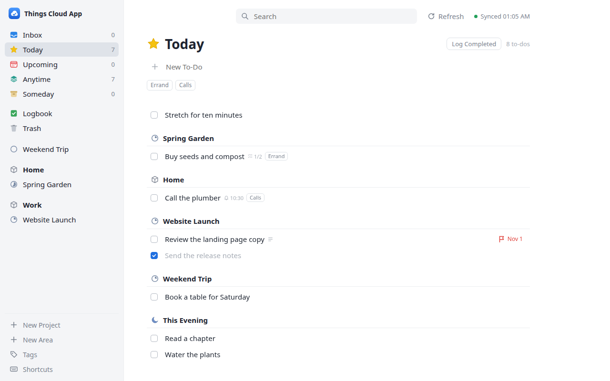

# NubeRerum

> **Unofficial.** Not affiliated with or endorsed by Cultured Code. Things is a trademark of Cultured Code GmbH & Co. KG.
>
> **Use at your own risk:** this app writes to your Things data through an unofficial, reverse-engineered protocol. Back up your Things data first.



NubeRerum is a small self-hosted web app for Things 3 tasks in Things Cloud. It runs in Docker on a home server. It does not need a Mac that is always running.

Cultured Code does not publish a Things Cloud API. The app therefore uses the reverse-engineered `things-cli` from [`arthursoares/things-cloud-sdk`](https://github.com/arthursoares/things-cloud-sdk) (release v0.6.0, with the patch in `patches/things-cloud-sdk-arthursoares.patch`).

## Features

- Inbox, Today, Upcoming, Anytime and Someday, plus Logbook and Trash. Membership and order follow Things.
- A sidebar ordered like Things: areas with their projects. Areas fold up, remembered per browser. Someday and Upcoming projects show in those lists.
- Projects grouped by heading; Today and the other lists grouped by area and project.
- Add to-dos in every list, project and area. New to-dos go to the top. Upcoming asks for a start date.
- Create projects, areas, headings and tags; rename and delete headings, areas and tags.
- This Evening in Today; cancel to-dos; reminders; make a to-do repeat; convert a to-do to a project.
- Projects: complete or cancel, When, deadline and tags in the header, a progress pie.
- Areas carry tags (set in the area header). A tag bar filters every list; to-dos match the tags of their project and area, as in Things.
- Edit a to-do in place: title, notes, checklist (add, edit, tick, delete, reorder), when, deadline and tags.
- Complete and reopen to-dos. Completed to-dos stay in their list until "Log Completed" (or Things' daily logging).
- Move to-dos to the Trash, restore them, and empty the Trash.
- Select with click, Shift and Ctrl/Cmd. Keyboard shortcuts after Things for Mac (Cmd on a Mac, Ctrl elsewhere; Alt where the browser keeps a combination), with a Move dialog, a navigation popover, duplicate, copy and paste. `?` or "Shortcuts" in the sidebar shows a cheat sheet.
- Drag and drop: reorder to-dos, checklist items, projects and areas; move selected to-dos onto a project, area, heading, Today, Anytime or Someday; move projects between areas. Long press on touch screens.
- Notes with clickable web links and a Markdown preview. Search, including the Logbook (grouped by month).
- Web app manifest and icons, so the app can be added to a home screen.
- Docker Compose deployment. Basic Auth for local and LAN use, passkeys (WebAuthn) for internet access.
- An MCP endpoint (`/mcp`) with project-bound tokens (by Things tag or UUID), so Claude Code can read, create, change, order and complete the to-dos of a project, with tags, notes and checklists, and create projects in a tagged area.

## Quick Start With Docker Compose

1. Copy the environment template:

   ```sh
   cp .env.example .env
   ```

2. Edit `.env`:

   ```sh
   APP_USERNAME=admin
   APP_PASSWORD=use-a-long-random-password
   THINGS_USERNAME=you@example.com
   THINGS_PASSWORD=your-things-cloud-password
   TZ=Europe/Berlin
   ```

3. Start the app. The image builds the patched `things-cli` itself:

   ```sh
   docker compose up -d --build
   ```

4. Open:

   ```text
   http://YOUR-SERVER:4173
   ```

See [docs/DEPLOYMENT.md](docs/DEPLOYMENT.md) for deployment, updates, passkey sign-in and logs.

## Local Development

```sh
./scripts/start-nubererum.sh
```

The script builds the patched CLI into `bin/things-cli` on the first start (`scripts/build-things-cli.sh`, needs Go and Git), builds the app and starts it on `127.0.0.1:4173`. Enter your Things Cloud credentials in the browser. Override the port with `PORT`, for example `PORT=4180 ./scripts/start-nubererum.sh`. To reach it from other devices, set `HOST=0.0.0.0` and an `APP_PASSWORD` of at least 16 characters (the app refuses to start without one).

## Security

Read [docs/SECURITY.md](docs/SECURITY.md) before you make the app reachable from other machines. The short version:

- Keep the repository private.
- On a LAN, set a long random `APP_PASSWORD`.
- For internet access, use passkeys (`APP_AUTH=passkey`) behind a TLS reverse proxy.
- Set `APP_READ_ONLY=1` on test instances that use a real Things account.
- Never commit `.env`, `passkeys.json`, `mcp-tokens.json`, CLI cache files (`things-cli-state*.json`) or local binaries.
- Coding agents (Claude Code) can read and complete the to-dos of chosen projects through `/mcp` with project-bound tokens; see [docs/DEPLOYMENT.md](docs/DEPLOYMENT.md#mcp-tokens-for-coding-agents).

## Today View

Today membership comes from:

```sh
things-cli today
```

The app adds project, area and heading data from the local CLI state cache. Cache fields such as `TodayIndex` only change the order, never membership. One exception: a completed to-do stays in Today until it is logged, as in Things.

## Test

Install the browser-test dependencies once:

```sh
npm install
npx playwright install chromium
```

Run the Go tests (on a host without Go, run them in a `golang:1.26-alpine` container, see [docs/testing.md](docs/testing.md)):

```sh
go vet ./...
go test ./...
```

Run the browser tests. The test runner starts the app, and the tests mock the API, so no Things account is used:

```sh
npm run test:e2e
```

To compare list membership and order with Things for Mac, follow [docs/PARITY_TESTING.md](docs/PARITY_TESTING.md).

Build:

```sh
go build -o nubererum ./cmd/nubererum
```

## License

MIT, see [`LICENSE`](LICENSE). Third-party components and their licenses are listed in [`THIRD_PARTY_NOTICES.md`](THIRD_PARTY_NOTICES.md). To report a vulnerability, see [`SECURITY.md`](SECURITY.md); to contribute, see [`CONTRIBUTING.md`](CONTRIBUTING.md).
